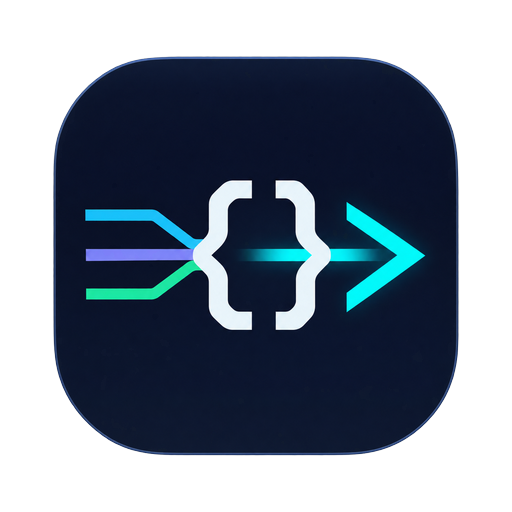
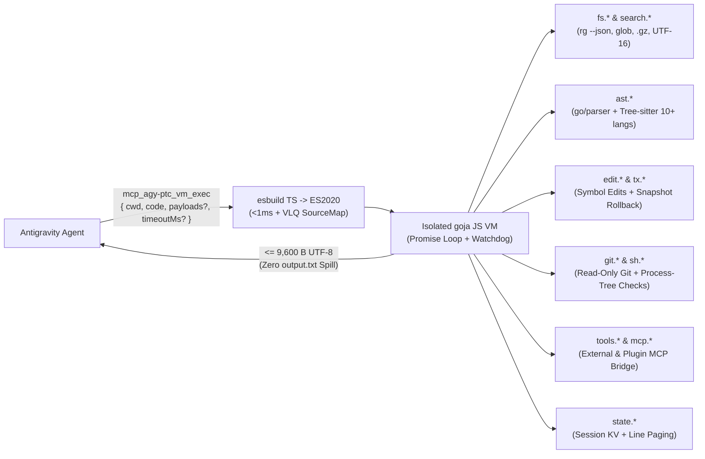

<p align="center">
  
</p>

<h1 align="center">AgyPTC (<code>agy-ptc</code>)</h1>

<p align="center">
  <strong>Programmatic Tool Calling (Code Mode) Runtime &amp; Plugin for Google Antigravity</strong><br/>
  <em>Collapse multi-step search, Tree-sitter/Go AST inspection, low-token atomic edits, fast checks, and MCP calls into one TypeScript turn.</em>
</p>

<p align="center">
  <strong>English</strong> · <a href="./README_ZH.md">简体中文</a>
</p>

<p align="center">
  <a href="https://github.com/Aliothmoon/agy-ptc/releases"></a>
  <a href="./LICENSE"></a>
  <a href="./go.mod"></a>
  <a href="./plugin/plugin.json"></a>
</p>

---

`AgyPTC` brings **Programmatic Tool Calling (Code Mode)**—inspired by Anthropic Programmatic Tool Calling, Cloudflare Code Mode, and [`pi-fabric`](https://github.com/fabric-runtime/pi-fabric)—natively to **Google Antigravity** (Antigravity App, Antigravity CLI `agy`, and IDE extensions).

> **Powered by [`MCPlex`](https://github.com/Aliothmoon/mcplex):** The client-agnostic Code Mode sandbox, TypeScript compiler, Tree-sitter/Go AST engine, edit/transaction capabilities, and MCP multiplexer live in [`github.com/aliothmoon/mcplex`](https://github.com/Aliothmoon/mcplex) (`pkg/...`). Use `MCPlex` directly for Claude Desktop, Cursor, Windsurf, Cline, or any generic MCP client; use `AgyPTC` for deep Antigravity integration (plugin bundle, auto-bootstrap supervisor, `SessionStart` snapshot hook, auxiliary UI sidecar panel, TUI statusline, rules, skills, and `ptc` agent).

Instead of burning 8–15 sequential LLM turns on `grep` -> `read_file` -> `read_file` -> `edit_file` -> `run_command` (and bloating the context window with raw intermediate outputs), the agent writes **one concise TypeScript program** executed via `mcp_agy-ptc_vm_exec`. Intermediate data, AST symbols, loops, and conditional checks stay inside sandbox memory, returning only a compact `<= 9.6 KB` structured summary (with automatic in-memory paging for long output).

---

## Why AgyPTC?

| Dimension | Sequential Tool Calling | AgyPTC (`mcp_agy-ptc_vm_exec`) |
| :--- | :--- | :--- |
| **Search -> Inspect -> Edit -> Verify** | 6–15 serial LLM round-trips | **1–2 turns** (loops & branching run in `<5ms` local TS VM) |
| **Intermediate Context Bloat** | Every grep dump & file slice enters chat history | Stays in Go sandbox RAM (up to 16 MB/file, 8 MB `sh.run` stdout); returns `<= 9.6 KB` |
| **Antigravity `>10 KB` `output.txt` Spills** | Spills to `.system_generated/steps/<N>/output.txt` (+1 read turn) | **0 disk spills** — oversized results page cleanly from `state.get("__result_N")` |
| **Low-Token Multi-File Refactoring** | Echoing 30+ unchanged context lines per `edit_file` | **`edit.replaceSymbol` / `edit.insertSymbol` (`0` target tokens)** + pre-write validation across all files & opt-in `tx.begin()` rollback |
| **Hung Subprocesses & Host Daemons** | Can stall turns, leak orphans, or kill shared `adb` | **Auto-extended deadline (`20s`..`120s`) + process-tree kill** while preserving shared Windows daemons (`adb`, `sccache`, `mspdbsrv`) |
| **Runtime Dependencies** | Heavy Python / Deno / Docker sandboxes | **Zero-setup static Go binary (`CGO_ENABLED=0`)** embedding `esbuild` + `goja` + `gotreesitter` |

---

## Architecture



### Smart Fast / Slow Task Division

`AgyPTC` complements Antigravity's native tools rather than replacing them:

- **Native `read_file` (in parallel)**: Reading 1–3 known small whole files (`<300` lines, 46 KB inline each without sharing PTC's 9.6 KB output budget).
- **`mcp_agy-ptc_vm_exec` (`<15s` multi-step & verify chains)**: Codebase search (`search.rg`/`glob`), AST outlining (`ast.outline`/`ast.read`), multi-file atomic edits (`edit.apply` + `sh.checks`), read-only `git.*` (incl. historical `git.query("grep ...")`), and fast compile/lint/scoped unit checks.
- **Native `run_command` + `manage_task` (`>15s` long/async jobs)**: Full integration/E2E suites, heavy builds (Gradle/Cargo/Docker), interactive commands, and `IsDaemon: true` servers—preserving live `/tasks` streaming and Reactive Wakeup.
- **Compatible with [`rtk`](https://github.com/rtk-ai/rtk)**: `rtk` hooks `PreToolUse` on `run_command` only, never mutating structured stdout inside `AgyPTC`'s internal `sh.run`/`sh.exec` calls.

---

## Installation

### Option 1: One-Line Plugin Install (Zero Go Toolchain Required)

Requires **Antigravity (`agy`)** with **Node.js `18+`** on `PATH` (`ripgrep` `rg` optional & recommended).

```bash
# Install directly from GitHub (Windows, macOS, Linux — x64 & arm64)
agy plugin install https://github.com/Aliothmoon/agy-ptc/tree/main/plugin
```

On first launch (and automatically across plugin version updates), the bundled `launch.mjs` supervisor downloads the matching platform archive + `checksums.txt` from GitHub Releases, verifies its **SHA-256** digest, and extracts the static `agy-ptc` binary into `${PLUGIN_DATA}/bin/`.

### Option 2: Prebuilt Release Archive (Includes Standalone `agy-ptc` CLI & TUI)

Download the archive for your platform from [**GitHub Releases**](https://github.com/Aliothmoon/agy-ptc/releases) to also install the global `agy-ptc` CLI (`agy-ptc logs` live TUI, `stats`, `bench`, `doctor`):

```bash
# macOS / Linux
mkdir -p agy-ptc && tar -xzf agy-ptc_<version>_<os>_<arch>.tar.gz -C agy-ptc
./agy-ptc/agy-ptc install

# Windows (PowerShell)
Expand-Archive agy-ptc_<version>_windows_amd64.zip -DestinationPath agy-ptc
.\agy-ptc\agy-ptc.exe install
```

### Option 3: Build from Source

Requires **Go `1.27+`**:

```bash
git clone https://github.com/Aliothmoon/agy-ptc.git
cd agy-ptc

# macOS / Linux
CGO_ENABLED=0 go build -trimpath -ldflags="-s -w" -o agy-ptc ./cmd/agy-ptc && ./agy-ptc install

# Windows (PowerShell)
$env:CGO_ENABLED="0"; go build -trimpath -ldflags="-s -w" -o agy-ptc.exe ./cmd/agy-ptc; .\agy-ptc.exe install
```

### Recommended Antigravity CLI Settings (`~/.gemini/antigravity-cli/settings.json`)

Allow `mcp(agy-ptc_vm/exec)` so PTC runs without repetitive approval prompts, and optionally enable the live CLI status bar:

```json
{
  "allowNonWorkspaceAccess": true,
  "permissions": {
    "allow": [
      "mcp(agy-ptc_vm/exec)"
    ]
  },
  "statusLine": {
    "type": "command",
    "command": "agy-ptc statusline",
    "stack_with_default": true
  }
}
```

### Modes of Operation

1. **Hybrid Mode (Default)**: Active automatically in every session once enabled. Bundles `mcp_agy-ptc_vm_exec`, routing rule `rules/AGENTS.md`, skills `/ptc-exec` & `/ptc-refactor`, `SessionStart` workspace snapshot hook, and the **AgyPTC (`PTC Panel`)** auxiliary Web UI sidecar in the Antigravity App.
2. **Dedicated `ptc` Agent / Subagent**: Invoke `ptc` via `invoke_subagent(TypeName: "ptc", ...)` or launch `agy --agent ptc` (or `/agents`) for a pure Code Mode specialist.

---

## Sandbox TypeScript API Reference

`code` runs as an `async` TypeScript function body (`top-level await`, `print()`/`console.log()`, and `return` work directly). Built-in Node globals and `import ... from "node:<mod>"` / `await import("node:...")` are available out of the box (`Buffer`, `zlib`, `util`, `assert`, `events`, `querystring`, `string_decoder`, `module`, `path`, `crypto`, `URL`/`URLSearchParams`, `TextEncoder`/`TextDecoder`, `btoa`/`atob`, `performance`, `setTimeout`, `structuredClone`, `sleep`, read-only `process` & `os`). Always pass the active workspace root in `cwd`.

### Payloads (`P` / `payloads`)
Pass multiline code or templates in top-level `payloads: { newFn: "..." }` and reference `P.newFn` inside `code`—eliminating nested JSON string escaping errors. Missing `P.<key>` references fail preflight **before** any side effects run.

### Filesystem & Search (`fs.*`, `search.*`)
```ts
const [hits, testFiles, stat] = await Promise.all([
  search.rg("NewEngine", { path: "pkg", glob: "*.go", literal: true }),
  search.glob("**/*_test.go", { detail: true }),
  fs.stat("go.mod"),
]);
const tail = await fs.read("app.log.gz", { tail: 80, lineNumbers: true });
```
- `fs.read(path, { startLine?, endLine?, tail?, lineNumbers?, maxBytes? })` (`2 MB` default, up to `16 MB` via `{ maxBytes }`; transparently gunzips `.gz` and decodes UTF-16LE/BE BOM logs)
- `fs.cat(paths, opts?)` -> `{ [path]: text | null }` · `fs.bytes(path, { offset?, length? })` -> `Buffer` · `fs.hash(path, algo?)` (`sha256` default)
- `fs.write(path, content, { eol? })` · `fs.mkdir` · `fs.rm` · `fs.rename` · `fs.cp` · `fs.exists(path)` · `fs.stat(path)` (incl. `mtimeMs`) · `fs.list(path, { detail? })` · `fs.tree(path, depth?)`
- `search.rg(pattern, { path?, glob?, literal?, ignoreCase?, contextLines?, maxResults?, filesOnly?, count? })`
- `search.glob(pattern, { path?, maxResults?, detail? })` (supports `{a,b}` braces; `{ detail: true }` returns `[{ path, size, mtimeMs }]`)

### AST Symbol Outlines (`ast.*`)
```ts
const outline = await ast.outline("pkg/sandbox/executor.go");
const fn = await ast.read("pkg/sandbox/executor.go", "Executor.Execute");
const sym = await ast.enclosingSymbol("pkg/sandbox/executor.go", 320);
```
- Exact `go/parser` AST for Go + pure-Go **Tree-sitter** AST (`gotreesitter`) incl. class/impl methods across C, C++, Rust, Python, TypeScript, TSX, JavaScript, Java, Kotlin, C#, and Markdown.

### Low-Token Edits (`edit.*`) & Opt-In Transactions (`tx.*`)
Choose the lowest-token edit mode (`edit.apply` validates **every** hunk across all files before touching disk; keep edits on check failure so the next turn sends only the fix):

```ts
// 1. Default: low-token symbol / span edits + fast verification
await edit.apply({
  edits: [
    { path: "pkg/service/handler.go", hunks: [{ symbol: "Server.Handle", replaceSymbol: true, replacement: P.newHandle }] },
    { path: "pkg/service/new_helper.go", create: P.helperFile, overwrite: true },
  ],
});
const checks = await sh.checks(["go vet ./...", "go test ./pkg/service/..."]);
return checks;
```

When a failed check **must** leave the working tree untouched, wrap in `tx.begin()` (uncommitted transactions auto-rollback on error or timeout):

```ts
const t = await tx.begin();
await t.replaceSymbol("pkg/service/handler.go", "Server.Handle", P.newHandle);
const v = await t.verify(["go vet ./...", "go test ./pkg/service/..."]);
if (!v.ok) {
  await t.rollback();
  return v.failures;
}
await t.commit();
```

### Read-Only Git & Bounded Shell (`git.*`, `sh.*`)
```ts
const [status, log, prHits] = await Promise.all([
  git.status(),
  git.log({ n: 5, format: "--oneline" }),
  git.query('grep -n "NewEngine" HEAD~3 -- pkg'),
]);

const checks = await sh.checks(["go vet ./...", "go test ./pkg/compiler/..."]);
const pkgs = await sh.run("go", ["list", "-json", "./..."]); // direct argv, no shell quoting issues
```
- Read-only `git.*`: `status`, `diff`, `log`, `show`, `branch`, `blame`, and `query` (`rev-parse`, `grep`, `for-each-ref`, `show-ref`, `rev-list`, `ls-files`, `ls-tree`, `merge-base`, `describe`, `worktree list`, `stash list`, `stash show`).
- Smart deadline extension: omitting top-level `timeoutMs` defaults to `20s`, and automatically extends up to `120s` when an inner `sh.exec`, `sh.run`, `sh.checks`, or `t.verify` explicitly passes a larger `timeoutMs`/`timeoutSec`.

### Session State (`state.*`) & External MCP Bridge (`tools.*`, `mcp.*`)
```ts
const found = await tools.search("wiki");
if (found.length > 0) {
  const res = await mcp.deepwiki.read_wiki_structure({ repoName: "evanw/esbuild" });
  state.set("lastWiki", res.data ?? res.text);
  print(res.text.slice(0, 600));
}
```
- Oversized outputs (`>9.6 KB`) auto-save to `state.get("__result_N")` with line-aligned paging (`print(state.page("__result_1", 2))`).
- Discovers both global `~/.gemini/config/mcp_config.json` and enabled plugin `mcp_config.json` servers. Remote OAuth MCP servers managed privately by `agy` CLI fast-fail HTTP `401`/`403` with `NeedsApproval`, guiding the agent to call native `call_mcp_tool` directly without asking the user to re-login.

---

## Observability: App Sidecar & CLI Console

- **Antigravity App Sidecar (`PTC Panel`)**: Open the **PTC Panel** tab in the Antigravity App auxiliary pane to inspect live execution feeds, per-capability trace timings, error categories, and doctor diagnostics.
- **Interactive Terminal TUI (`agy-ptc`)**:

```bash
agy-ptc logs                           # Open interactive live TUI console (diffs, sessions, tabs, modal inspect)
agy-ptc errors                         # Open interactive TUI filtered directly to Errors
agy-ptc logs --plain -f                # Plain CLI live-tail (auto-selected when piped or --json/--full/--id)
agy-ptc logs --id <ptc_id>             # Inspect full source & op trace for a specific run ID
agy-ptc stats                          # Aggregate error categories & capability hotspots
agy-ptc bench --recent 15              # Measure tool-per-turn & output.txt spill metrics from local transcripts
agy-ptc doctor                         # Run MCP handshake, SessionStart hook, and strict agy plugin validation
agy-ptc uninstall --purge              # Remove plugin installation, CLI binary, and all plugin_data/cache dirs
```

---

## Security & Policy Boundaries

> **Scope**: AgyPTC's policy layer is a **guardrail against accidental model mistakes, not an OS-level sandbox**. `sh.exec` runs real shell commands; for untrusted code or prompts, enable OS/container sandboxing.

- **Settings-Aligned Permissions**: Honors `~/.gemini/antigravity-cli/settings.json` (`user Deny > built-in guard > user Ask > user Allow`). Set `AGY_PTC_STRICT_WORKSPACE=1` or `"allowNonWorkspaceAccess": false` to block all paths outside `cwd`.
- **Credential & Self-Escalation Guards**: Blocks reads/writes to `~/.ssh`, `~/.gnupg`, `~/.aws`, `~/.kube`, `~/.docker/config.json`, `~/.git-credentials`, `~/.netrc`, `~/.npmrc`, `~/.config/gh`, `~/.config/gcloud`, OAuth token stores, `.git/hooks`, `.git/config`, and requires approval before touching agent/MCP configs (`settings*.json`, `mcp_config.json`, `hooks.json`, `policy.json`) or shell startup profiles.
- **Destructive Command Escalation (`NeedsApproval`)**: Recursive force deletes (`rm -rf`, `Remove-Item -Recurse -Force`), history/remote git mutations (`git push`, `reset --hard`, `clean -f`, `checkout -- .`, `branch -D`), disk/system commands, pipe-to-shell execution, and package/infra publishing throw `NeedsApproval` so native `run_command` can prompt the user.
- **Untrusted Workspace MCP Protection**: `<workspace>/.agents/mcp_config.json` is ignored unless explicitly trusted via `AGY_PTC_TRUST_WORKSPACE_MCP=1` or `"agyPtcTrustWorkspaceMcp": true` in `~/.gemini/config/agy-ptc/policy.json`.

---

## Project Layout

```text
AgyPTC/
├── cmd/agy-ptc/             # CLI entrypoint (mcp, hook, statusline, run, logs, errors, stats, bench, install, uninstall, doctor)
├── internal/
│   ├── snapshot/            # <= 1.5 KB SessionStart workspace snapshot & CLI statusline
│   ├── bench/               # Antigravity transcript.jsonl turn & spill analyzer
│   └── version/             # Release version (synced with plugin/plugin.json)
└── plugin/                  # Antigravity plugin bundle
    ├── plugin.json          # Manifest ($schema validated via `agy plugin validate --strict`)
    ├── scripts/launch.mjs   # Supervised MCP proxy, hot-reload & verified SHA-256 binary auto-bootstrap
    ├── sidecars/ptc_panel/  # Antigravity App auxiliary Web UI panel
    ├── agents/ptc.md        # Dedicated Code Mode agent / subagent
    ├── rules/AGENTS.md      # Always-on routing & API quick reference
    └── skills/              # /ptc-exec and /ptc-refactor skills
```

---

## Acknowledgments & License

- Inspired by [`fabric-runtime/pi-fabric`](https://github.com/fabric-runtime/pi-fabric) and [`INK-Q/agy-fast`](https://github.com/INK-Q/agy-fast).
- Powered by [`MCPlex`](https://github.com/Aliothmoon/mcplex), [`evanw/esbuild`](https://github.com/evanw/esbuild), [`dop251/goja`](https://github.com/dop251/goja), and [`odvcencio/gotreesitter`](https://github.com/odvcencio/gotreesitter).
- Released under the [MIT License](./LICENSE).
