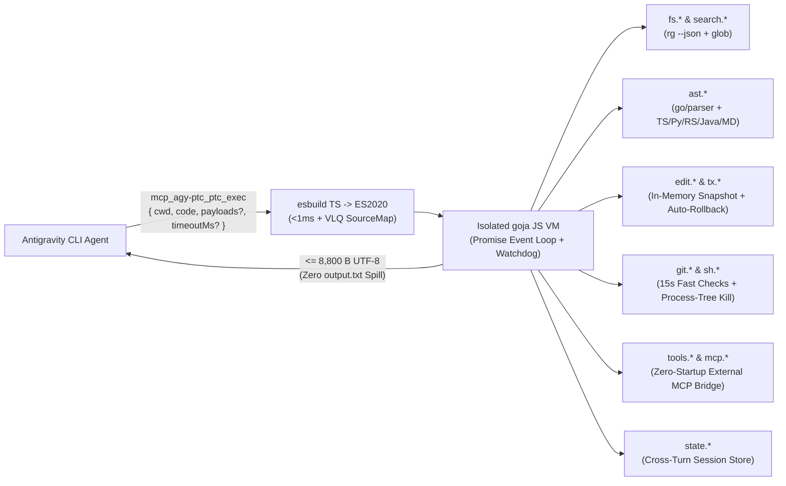

# AgyPTC (`agy-ptc`)

**English** | [简体中文](./README_ZH.md)

**Programmatic Tool Calling (Code Mode) Runtime & Plugin for Google Antigravity CLI (`agy`)**

[](./LICENSE)
[-00ADD8?logo=go)](./go.mod)
[-8E75B2)](./plugin/plugin.json)

`AgyPTC` brings **Code Mode / Programmatic Tool Calling (PTC)**—inspired by Cloudflare Code Mode, Anthropic Programmatic Tool Calling, and [`pi-fabric`](https://github.com/fabric-runtime/pi-fabric)—natively to **Antigravity CLI (`agy`)**.

Instead of burning 8–15 sequential LLM turns on `grep` -> `read_file` -> `read_file` -> `edit_file` -> `run_command` (and bloating the conversation window with raw intermediate outputs), the agent writes **one short TypeScript program** invoked via `mcp_agy-ptc_ptc_exec`. Intermediate files, AST symbols, loops, and conditional checks stay inside sandbox memory, returning only a compact `<= 9.6 KB` structured summary (or custom `maxOutputBytes`) to the model.

---

## Why AgyPTC?

| Dimension | Sequential Tool Calling | AgyPTC (`mcp_agy-ptc_ptc_exec`) |
| :--- | :--- | :--- |
| **Multi-step Search -> Read -> Edit -> Verify** | 6–15 serial LLM round-trips | **1–2 turns** (loops & branching run in `<5ms` local VM) |
| **Intermediate Context Bloat** | Every file slice & grep dump enters LLM history | Stays in Go sandbox RAM (up to 2 MB/file, 256 KB/cmd); returns compact JSON (`<= 9.6 KB`) |
| **Antigravity `>10 KB` MCP Disk Spills** | Spills to `.system_generated/steps/<N>/output.txt` (+1 read turn) | **0 disk spills** — oversized results auto-save to `state.get("__last_result")` |
| **Multi-File Refactoring Safety** | Partial broken edits left on disk when tests fail | **Atomic `tx.begin()`** snapshots files in RAM & auto-rolls back on failure/timeout |
| **Accidental Long/Hung Commands** | Can stall turns or leak orphan child processes | **`20s` default deadline + recursive process-tree kill** (`taskkill /T /F` / `-pgid` + `WaitDelay`) |
| **External Runtime Dependencies** | Heavy Python/Deno/Docker sandboxes | **Single static Go binary (`CGO_ENABLED=0`)** embedding `esbuild` + `goja` |

---

## Architecture



### Smart Fast / Slow Task Division

`AgyPTC` is designed to **complement**, not fight, Antigravity CLI's native background task manager:

- **Inside `mcp_agy-ptc_ptc_exec` (`<15s` fast operations)**: Codebase search (`search.rg`/`glob`), AST outlining (`ast.outline`), multi-file reads/filtering, transactional edits (`tx.begin`), read-only git, and fast compile/lint/scoped unit checks (`go vet ./...`, `tsc --noEmit`, `go test ./pkg/...`).
- **Native `run_command` + `manage_task` (`>15s` long/async operations)**: Full integration/E2E suites, heavy builds (Gradle/Cargo/Docker), interactive prompts, and `IsDaemon: true` dev servers—preserving live `/tasks` log streaming and Reactive Wakeup.
- **Compatible with [`rtk`](https://github.com/rtk-ai/rtk)**: `rtk` hooks `PreToolUse` on `run_command` only; it never mutates raw JSON stdout inside `AgyPTC`'s internal subprocesses while still compressing native `run_command` outputs.

---

## Quick Start

### Prerequisites

- **Go** `1.25+` (to build from source)
- **Antigravity CLI (`agy`)** `1.5+` (with `node` available on `PATH` for cross-platform plugin launch)
- **`ripgrep` (`rg`)** *(optional, recommended — `AgyPTC` automatically falls back to a built-in pure-Go regex engine if `rg` is absent)*

### 1. Build & Install

```bash
git clone https://github.com/aliothmoon/agy-ptc.git
cd agy-ptc

# macOS / Linux
CGO_ENABLED=0 go build -trimpath -ldflags="-s -w" -o agy-ptc ./cmd/agy-ptc
./agy-ptc install

# Windows (PowerShell)
$env:CGO_ENABLED="0"; go build -trimpath -ldflags="-s -w" -o agy-ptc.exe ./cmd/agy-ptc
.\agy-ptc.exe install
```

`agy-ptc install` automatically:
1. Installs the plugin bundle + binary into `~/.gemini/config/plugins/agy-ptc` (safe in-place hot-swap even if an MCP server is currently running on Windows).
2. Syncs the `agy-ptc` CLI binary into your user Go bin directory (`$GOBIN` / `$GOPATH/bin`) so `agy-ptc` works globally in any terminal.
3. Enables the plugin in Antigravity CLI (`agy plugin enable agy-ptc`) and runs `agy-ptc doctor` (`agy plugin validate --strict` + live MCP round-trip + `SessionStart` hook latency check).

### 2. Recommended Antigravity CLI Settings (`~/.gemini/antigravity-cli/settings.json`)

Allow `mcp(agy-ptc_ptc/exec)` so PTC runs without repetitive approval prompts, and optionally enable the live TUI status bar:

```json
{
  "allowNonWorkspaceAccess": true,
  "permissions": {
    "allow": [
      "mcp(agy-ptc_ptc/exec)"
    ]
  },
  "statusLine": {
    "type": "command",
    "command": "agy-ptc statusline",
    "stack_with_default": true
  }
}
```

### 3. Two Modes of Operation

1. **Hybrid Mode (Default)**: Active automatically in every `agy` session once installed. Quick 1–3 file reads use native `read_file`; multi-step exploration, AST inspection, transactional refactoring, and `<15s` checks route through `mcp_agy-ptc_ptc_exec`; `>15s` tasks use native `run_command` + `manage_task`.
2. **Strict Code Mode (`ptc` Agent)**: Start `agy --agent ptc` (or select `ptc` via `/agents`) to run a dedicated Code Mode agent whose system prompt and tool allowlist center strictly around `mcp_agy-ptc_ptc_exec`.

> **Note (Antigravity Desktop Swarm)**: Fresh `swarm(action="add")` workers do not inherit configured MCP servers unless spawned with `fork` (e.g., `fork="coordinator"`); see [forum issue #201194](https://discuss.ai.google.dev/t/bug-fresh-swarm-workers-cannot-access-configured-mcp-servers-call-mcp-tool-missing-context-permission-denied/201194).

---

## Sandbox TypeScript API Reference

`code` is compiled as the body of an `async` TypeScript function (`top-level await` and `return` work directly; `import type` is stripped cleanly). Standard zero-I/O utilities (`Buffer`, `btoa`/`atob`, `TextEncoder`/`TextDecoder`, `path`, `crypto`, `URL`/`URLSearchParams`) are available globally out of the box. Always pass the active project root in `cwd`.

### Payloads (`P` / `payloads`)
Pass multiline replacement blocks or templates via top-level `payloads: { afterCode: "..." }` and read them via `P.afterCode` inside `code`—avoiding nested JSON escaping errors. Missing `P.<key>` references fail preflight **before** any host operation executes.

### Filesystem & Search (`fs.*`, `search.*`)
```ts
const [hits, files, modText] = await Promise.all([
  search.rg("NewEngine", { path: "internal", glob: "*.go", literal: true }),
  search.glob("**/*_test.go"),
  fs.read("go.mod"),
]);
const slice = await fs.read("internal/runtime/engine.go", { startLine: 1, endLine: 60, lineNumbers: true });
const tree = await fs.tree(".", 2);
```
- `fs.read(path, { startLine?, endLine?, lineNumbers? })` (2 MB/file sandbox cap) · `fs.write(path, content)` · `fs.exists(path)` · `fs.stat(path)` · `fs.list(path)` · `fs.tree(path, depth?)`
- `search.rg(pattern, { path?, glob?, literal?, ignoreCase?, contextLines?, maxResults? })`
- `search.glob(pattern, { path?, maxResults? })` (supports `{a,b}` braces + automatic fallback recovery)
- **External Paths**: Relative paths resolve against `cwd`; external non-sensitive paths (`D:/OtherRepo/...`, `../shared/...`) are also supported across all capabilities unless disabled by policy.

### AST Symbol Outlines (`ast.*`)
```ts
const outline = await ast.outline("internal/sandbox/executor.go");
const sym = await ast.enclosingSymbol("internal/sandbox/executor.go", 320);
const batch = await ast.outlines(["internal/policy/policy.go", "internal/output/budget.go"]);
```
- Exact `go/parser` AST for `.go`; fast structural scanner for TypeScript, JavaScript, Python, Rust, Java, and Markdown.

### Atomic Multi-File Transactions (`tx.*` & `edit.*`)
Uncommitted transactions **automatically roll back** byte-for-byte (preserving CRLF/LF and file permissions) if verification fails, an exception is thrown, or `timeoutMs` expires:

```ts
const t = await tx.begin();

await t.edit("internal/service/handler.go", [
  {
    startLine: 40,
    endLine: 75,
    target: P.before,
    replacement: P.after,
  },
]);

const check = await t.verify([
  { name: "vet", command: "go vet ./..." },
  { name: "unit", command: "go test ./internal/service/..." },
]);

if (!check.ok) {
  await t.rollback();
  return { committed: false, failures: check.failures };
}

await t.commit();
return { committed: true, summary: check.summary };
```

### Read-Only Git & Bounded Shell (`git.*`, `sh.*`)
```ts
const [status, log] = await Promise.all([
  git.status(),                    // Safe in non-git folders too ({ isRepo: false })
  git.log("-n 5 --oneline"),
]);

// settle: true by default (non-zero exit returns { ok: false, exitCode, timedOut, output })
const vet = await sh.exec("go vet ./...", { timeoutSec: 15, compact: true });
const checks = await sh.checks(["go vet ./...", "go test ./internal/compiler/..."]);
```

### Cross-Turn Session State (`state.*`) & External MCP Bridge (`tools.*`, `mcp.*`)
```ts
// Discover cached Antigravity MCP tool schemas at <1ms zero startup cost:
const found = await tools.search("wiki");
if (found.length > 0) {
  const schema = await tools.describe(found[0].ref);
  const res = await mcp.deepwiki.read_wiki_structure({ repoName: "evanw/esbuild" });
  state.set("lastWiki", res);
  return { ref: schema.ref, preview: res.text.slice(0, 400) };
}
```
- If a return value exceeds `9,600` UTF-8 bytes (or custom `maxOutputBytes`), `AgyPTC` automatically compacts JSON whitespace first, and if still larger, returns a head+tail preview inline while storing the full object in `state.get("__last_result")` (and `state.get("__result_N")`) for zero-cost slicing in the next turn.

---

## Timeout & Anti-Hang Protection

To prevent accidental long tasks (`npm run dev`, full E2E suites, infinite loops) from freezing turns:

1. **Top-Level `timeoutMs`**: Defaults to **`20,000ms` (`20s`)**, configurable from `500ms` to `120,000ms` (`120s`) via `{ timeoutMs }` (or environment variables `AGY_PTC_DEFAULT_TIMEOUT_MS` / `AGY_PTC_MAX_TIMEOUT_MS`).
2. **Per-Command Shell Timeout**: `sh.exec` / `sh.checks` / `tx.verify` default to **`15s`** per command (`{ timeoutSec }` or `{ timeoutMs }`).
3. **Recursive Process-Tree Kill + Pipe `WaitDelay`**:
   - **Windows**: Spawns subprocesses with `CREATE_NEW_PROCESS_GROUP` and terminates the entire descendant tree via `taskkill /T /F /PID <pid>` + `WaitDelay: 500ms` so grandchild processes holding `stdout`/`stderr` pipes can never deadlock `cmd.Run()`.
   - **Unix (Linux / macOS)**: Spawns with `Setpgid: true` and kills `-pgid` with `SIGKILL` + `WaitDelay: 500ms`.
4. **Safe Rollback Ordering**: On timeout, child process trees are killed and drained **before** open `tx.*` file snapshots are restored, preventing Windows file-lock contention.

---

## Observability & CLI Reference

Antigravity CLI's default `"verbosity": "medium"` collapses MCP calls in the chat TUI to a compact summary line. To inspect full TypeScript inputs, traces, and outputs in real time:

- Press **`Ctrl+O`** inside `agy` (or set `"verbosity": "high"` in `~/.gemini/antigravity-cli/settings.json`), **or**
- Run **`agy-ptc logs -f`** in a side terminal pane!

```bash
agy-ptc logs -f                        # Live-tail incoming PTC TypeScript code, host ops, and return output
agy-ptc logs --full --tail 10          # Inspect recent executions in full
agy-ptc errors                         # Show only failed runs and caught capability errors
agy-ptc logs --id <ptc_id>             # Inspect full source & trace for a specific run ID
agy-ptc stats                          # Aggregate error categories & capability hotspots
agy-ptc bench --recent 15              # Measure tool-per-turn & output.txt spill metrics from local transcripts
agy-ptc run --cwd . --code "return await git.status()"
agy-ptc doctor                         # Run MCP handshake, SessionStart hook, and strict agy validation
agy-ptc uninstall                      # Cleanly remove global/project plugin installation
```

---

## Security & Policy Boundaries

- **Settings-Aligned Permissions**: Reads `~/.gemini/antigravity-cli/settings.json` (`Deny > Ask > Allow`). Set `AGY_PTC_STRICT_WORKSPACE=1` (or `"allowNonWorkspaceAccess": false`) to strictly block all paths outside `cwd`.
- **Symlink & Credential Guards**: Resolves symlinks via `filepath.EvalSymlinks` and unconditionally blocks sensitive paths (`~/.ssh`, `~/.gnupg`, `~/.aws`, Antigravity `mcp_oauth_tokens.json`, `.git/hooks`, system OS directories).
- **Destructive Command Gate**: Commands such as `git push`, `git reset --hard`, `rm -rf`, `sudo`, etc. are never executed silently inside `sh.exec`; they return `APPROVAL_REQUIRED` so the agent escalates to native `run_command` for explicit user confirmation.

---

## Project Layout

```text
AgyPTC/
├── cmd/agy-ptc/             # CLI entrypoint (mcp, hook, statusline, run, logs, errors, stats, bench, install, doctor)
├── internal/
│   ├── compiler/            # esbuild TS -> ES2020 transpiler, VLQ sourcemapper & payload preflight check
│   ├── sandbox/             # Isolated goja VM, async goroutine -> microtask loop, watchdog & op budget
│   ├── capabilities/        # fs, search, ast, edit, tx, git, sh, state, external mcp bridge & process-tree control
│   ├── policy/              # Symlink resolution, credential guards & settings.json rule evaluator
│   ├── output/              # <= 8,800 B UTF-8 water-filling budgeter & terminal noise/ANSI stripper
│   ├── runtime/             # Engine wiring, workspace cwd resolution, auto-spill & live-status writer
│   ├── mcpserver/           # Stdio JSON-RPC 2.0 MCP server (NDJSON + Content-Length framing)
│   ├── snapshot/            # <= 1.5 KB SessionStart workspace snapshot & TUI statusline
│   ├── audit/               # JSONL execution/error logger & hotspot classifier
│   └── bench/               # Antigravity transcript.jsonl efficiency analyzer
└── plugin/                  # Antigravity CLI plugin bundle (plugin.json, mcp_config.json, hooks.json, rules, agents, skills)
```

---

## Acknowledgments

- Inspired by [`fabric-runtime/pi-fabric`](https://github.com/fabric-runtime/pi-fabric) (Code Mode / Programmatic Tool Calling design, flat payload ergonomics, and transactional verification) and [`INK-Q/agy-fast`](https://github.com/INK-Q/agy-fast) (Antigravity CLI plugin & inline byte-budget conventions).
- Powered by [`evanw/esbuild`](https://github.com/evanw/esbuild) and [`dop251/goja`](https://github.com/dop251/goja).

## License

Released under the [MIT License](./LICENSE).
