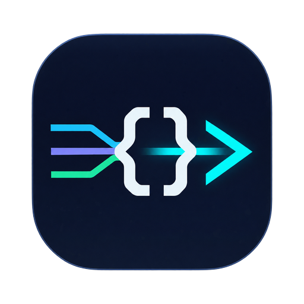
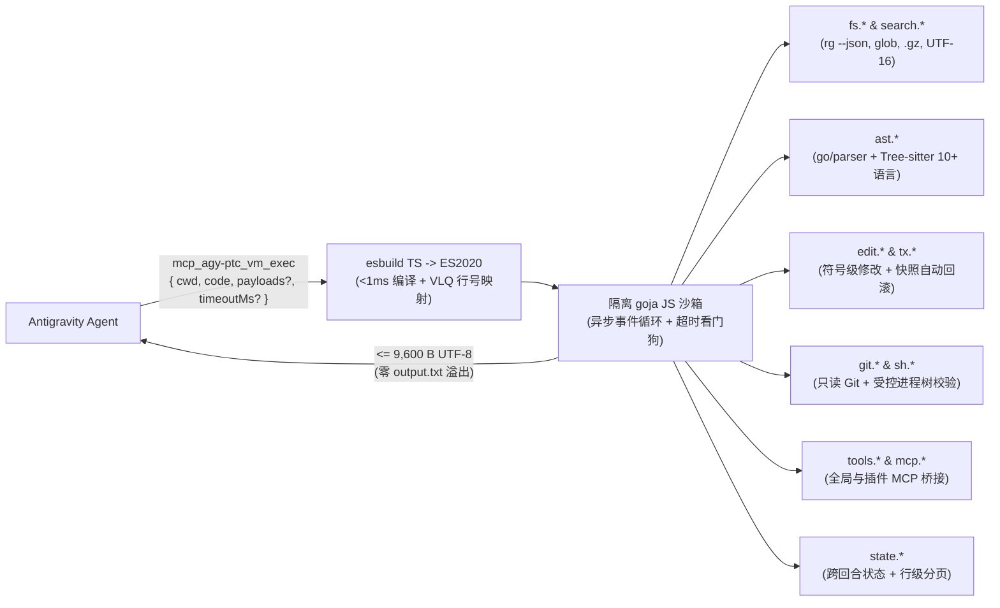

<p align="center">
  
</p>

<h1 align="center">AgyPTC (<code>agy-ptc</code>)</h1>

<p align="center">
  <strong>面向 Google Antigravity 的编程式工具调用（Code Mode / PTC）运行时与插件</strong><br/>
  <em>将多步代码搜索、Tree-sitter/Go AST 分析、低 Token 跨文件原子修改、快速校验与外部 MCP 编排收敛至单轮 TypeScript 执行。</em>
</p>

<p align="center">
  <a href="./README.md">English</a> · <strong>简体中文</strong>
</p>

<p align="center">
  <a href="https://github.com/Aliothmoon/agy-ptc/releases"></a>
  <a href="./LICENSE"></a>
  <a href="./go.mod"></a>
  <a href="./plugin/plugin.json"></a>
</p>

---

`AgyPTC` 受 Anthropic Programmatic Tool Calling、Cloudflare Code Mode 与 [`pi-fabric`](https://github.com/fabric-runtime/pi-fabric) 启发，为 **Google Antigravity 全家桶**（Antigravity 桌面端 App、Antigravity CLI `agy` 与 IDE 扩展）提供原生的 **编程式工具调用（Code Mode / PTC）** 能力。

> **基于共享核心 [`MCPlex`](https://github.com/Aliothmoon/mcplex) 构建：** 客户端无关的 Code Mode 沙箱、TypeScript 编译器、Tree-sitter/Go AST 引擎、原子编辑/事务能力与 MCP 桥接统一维护在 [`github.com/aliothmoon/mcplex`](https://github.com/Aliothmoon/mcplex)（`pkg/...`）。若需接入 Claude Desktop、Cursor、Windsurf、Cline 等通用 MCP 客户端，可直接使用 `MCPlex`；`AgyPTC` 专注提供 Antigravity 深度原生集成（插件包、零依赖二进制自动拉取自举、`SessionStart` 快照钩子、桌面端 Sidecar 监控面板、CLI 状态栏、规则、技能与 `ptc` 专属子智能体）。

传统 Agent 工具调用往往需要串行往返 8～15 个回合（`grep` -> `read_file` -> `read_file` -> `edit_file` -> `go test`），不仅回合延迟高，还会把大量中间文本塞进对话上下文，甚至触发 Antigravity `>10 KB` 的 `output.txt` 落盘惩罚。借助 `AgyPTC`，模型只需向 `mcp_agy-ptc_vm_exec` 提交**一段精简的 TypeScript 脚本**，中间数据、AST 符号、循环过滤与条件分支全部留在本地 Go 沙箱内存中，仅向模型返回 `<= 9.6 KB` 的紧凑结果（超长输出自动驻留内存分页）。

---

## 核心优势对比

| 维度 | 传统串行工具调用 | AgyPTC (`mcp_agy-ptc_vm_exec`) |
| :--- | :--- | :--- |
| **搜索 -> 分析 -> 修改 -> 验证链路** | 6～15 次串行 LLM 回合往返 | **1～2 个回合**（循环与分支在 `<5ms` 本地 TS 沙箱内完成） |
| **上下文窗口占用** | 每次 grep 与文件切片原样堆积进历史 | 中间数据留在沙箱内存（单文件最高 16 MB，`sh.run` 8 MB），仅返回 `<= 9.6 KB` 摘要 |
| **MCP `>10 KB` `output.txt` 落盘惩罚** | 超长输出被迫落盘，多花 1 个回合读取 | **0 磁盘溢出** — 超长文本存入 `state.get("__result_N")` 按行分页查看 |
| **低 Token 跨文件重构** | 每次 `edit_file` 需回显几十行原代码做定位 | **`edit.replaceSymbol` / `edit.insertSymbol`（`0` target token）** + 写前全量校验 & 可选 `tx.begin()` 失败自动回滚 |
| **子进程防卡死与守护进程兼容** | 容易拖死回合、残留孤儿进程或误杀宿主机 `adb` | **动态放宽超时（`20s`..`120s`）+ 递归清进程树**，同时保留宿主机共享守护进程（`adb`、`sccache`、`mspdbsrv`） |
| **外部运行时依赖** | 依赖重型 Python / Deno / Docker 沙箱 | **零配置纯静态 Go 单文件（`CGO_ENABLED=0`）**，内嵌 `esbuild` + `goja` + `gotreesitter` |

---

## 架构设计



### 快慢任务黄金分工

`AgyPTC` 与 Antigravity 原生工具互补协作：

- **原生 `read_file`（并行调用）**：直接读取 1～3 个已知的完整小文件（`<300` 行，单次 46 KB 内联额度，不占用 PTC 的 9.6 KB 输出预算）。
- **`mcp_agy-ptc_vm_exec`（`<15s` 多步编排与快速校验）**：代码搜索（`search.rg`/`glob`）、AST 符号定位与按符号读取（`ast.outline`/`ast.read`）、多文件原子编辑（`edit.apply` + `sh.checks`）、只读 `git.*`（含历史提交 `git.query("grep ...")`）及快速编译/类型检查/单包单测。
- **原生 `run_command` + `manage_task`（`>15s` 长耗时与常驻服务）**：全量集成测试/E2E、重型构建（Gradle/Cargo/Docker）、交互式命令及 `IsDaemon: true` 常驻服务——完整保留 `/tasks` 实时日志流与完成自动唤醒（Reactive Wakeup）。
- **与 [`rtk`](https://github.com/rtk-ai/rtk) 零冲突共存**：`rtk` 仅拦截顶层 `run_command`，不会篡改 `AgyPTC` 内部子进程的结构化标准输出。

---

## 快速安装

### 方式一：一行命令安装插件（推荐，无需 Go 环境）

只需已安装 **Antigravity (`agy`)** 且系统 `PATH` 中有 **Node.js `18+`**（推荐同时安装 `ripgrep` `rg`）：

```bash
# 直接从 GitHub 安装（支持 Windows / macOS / Linux，x64 & arm64）
agy plugin install https://github.com/Aliothmoon/agy-ptc/tree/main/plugin
```

首次启动（以及后续插件版本升级）时，内置的 `launch.mjs` 守护进程会自动从 GitHub Releases 下载对应系统架构的发布包与 `checksums.txt`，完成 **SHA-256 强校验**后解压至 `${PLUGIN_DATA}/bin/`，真正开箱即用。

### 方式二：下载预编译 Release 包（含独立 `agy-ptc` CLI 与实时 TUI）

如需在终端独立使用 `agy-ptc logs` 实时监控 TUI、`stats`、`bench`、`doctor` 等命令，可从 [**GitHub Releases**](https://github.com/Aliothmoon/agy-ptc/releases) 下载对应平台压缩包：

```bash
# macOS / Linux
mkdir -p agy-ptc && tar -xzf agy-ptc_<version>_<os>_<arch>.tar.gz -C agy-ptc
./agy-ptc/agy-ptc install

# Windows (PowerShell)
Expand-Archive agy-ptc_<version>_windows_amd64.zip -DestinationPath agy-ptc
.\agy-ptc\agy-ptc.exe install
```

### 方式三：从源码编译

环境要求：**Go `1.27+`**

```bash
git clone https://github.com/Aliothmoon/agy-ptc.git
cd agy-ptc

# macOS / Linux
CGO_ENABLED=0 go build -trimpath -ldflags="-s -w" -o agy-ptc ./cmd/agy-ptc && ./agy-ptc install

# Windows (PowerShell)
$env:CGO_ENABLED="0"; go build -trimpath -ldflags="-s -w" -o agy-ptc.exe ./cmd/agy-ptc; .\agy-ptc.exe install
```

### 推荐配置（`~/.gemini/antigravity-cli/settings.json`）

将 `mcp(agy-ptc_vm/exec)` 加入免确认白名单，并可选开启 CLI 底部实时状态栏：

```json
{
  "allowNonWorkspaceAccess": true,
  "permissions": {
    "allow": [
      "mcp(agy-ptc_vm/exec)"
    ]
  },
  "statusLine": {
    "type": "command",
    "command": "agy-ptc statusline",
    "stack_with_default": true
  }
}
```

### 工作模式

1. **混合模式（默认自动生效）**：启用插件后自动注入 `mcp_agy-ptc_vm_exec`、路由规则 `rules/AGENTS.md`、技能 `/ptc-exec` 与 `/ptc-refactor`、`SessionStart` 快照钩子，以及 Antigravity 桌面端侧边栏 **AgyPTC（`PTC Panel`）** 可视化监控面板。
2. **`ptc` 专属智能体 / 子智能体**：可通过 `invoke_subagent(TypeName: "ptc", ...)` 委派，或使用 `agy --agent ptc`（及 `/agents`）启动专注 Code Mode 的智能体。

---

## 沙箱 TypeScript API 速查

`code` 作为 `async` TypeScript 函数体直接编译（原生支持顶层 `await`、`print()`/`console.log()` 与 `return`）。内置丰富标准全局对象并支持 `import ... from "node:<mod>"` 与动态 `await import("node:...")`（涵盖 `Buffer`、`zlib`、`util`、`assert`、`events`、`querystring`、`string_decoder`、`module`、`path`、`crypto`、`URL`/`URLSearchParams`、`TextEncoder`/`TextDecoder`、`btoa`/`atob`、`performance`、`setTimeout`、`structuredClone`、`sleep` 及只读 `process` / `os`）。调用时请传入当前工作区根目录 `cwd`。

### 多行代码传参（`P` / `payloads`）
将多行替换代码放入顶层 `payloads: { newFn: "..." }`，在 `code` 中通过 `P.newFn` 引用，彻底规避多层 JSON 字符串转义问题；缺失的 `P.<key>` 会在编译期零副作用拦截。

### 文件系统与搜索（`fs.*`、`search.*`）
```ts
const [hits, testFiles, stat] = await Promise.all([
  search.rg("NewEngine", { path: "pkg", glob: "*.go", literal: true }),
  search.glob("**/*_test.go", { detail: true }),
  fs.stat("go.mod"),
]);
const tail = await fs.read("app.log.gz", { tail: 80, lineNumbers: true });
```
- `fs.read(path, { startLine?, endLine?, tail?, lineNumbers?, maxBytes? })`（默认 `2 MB`，传 `{ maxBytes }` 最高 `16 MB`；自动解压 `.gz` 文本并透明解码 Windows PowerShell 生成的 UTF-16LE/BE BOM 日志）
- `fs.cat(paths, opts?)` -> `{ [path]: text | null }` · `fs.bytes(path, { offset?, length? })` -> `Buffer` · `fs.hash(path, algo?)`（默认 `sha256`）
- `fs.write(path, content, { eol? })` · `fs.mkdir` · `fs.rm` · `fs.rename` · `fs.cp` · `fs.exists(path)` · `fs.stat(path)`（含数值 `mtimeMs`）· `fs.list(path, { detail? })` · `fs.tree(path, depth?)`
- `search.rg(pattern, { path?, glob?, literal?, ignoreCase?, contextLines?, maxResults?, filesOnly?, count? })`
- `search.glob(pattern, { path?, maxResults?, detail? })`（支持 `{a,b}` 花括号；`{ detail: true }` 返回 `[{ path, size, mtimeMs }]`）

### AST 符号大纲（`ast.*`）
```ts
const outline = await ast.outline("pkg/sandbox/executor.go");
const fn = await ast.read("pkg/sandbox/executor.go", "Executor.Execute");
const sym = await ast.enclosingSymbol("pkg/sandbox/executor.go", 320);
```
- Go 采用标准库 `go/parser` 精确解析；C、C++、Rust、Python、TypeScript、TSX、JavaScript、Java、Kotlin、C# 与 Markdown 采用纯 Go **Tree-sitter**（`gotreesitter`）精确提取函数、类与方法边界。

### 低 Token 原子编辑（`edit.*`）与按需事务回滚（`tx.*`）
默认使用 `edit.apply` 一次性提交所有文件修改（写入前先完成全部文件 hunk 校验；若后续 `sh.checks` 失败则保留磁盘修改，下一轮只需发增量补丁）：

```ts
await edit.apply({
  edits: [
    { path: "pkg/service/handler.go", hunks: [{ symbol: "Server.Handle", replaceSymbol: true, replacement: P.newHandle }] },
    { path: "pkg/service/new_helper.go", create: P.helperFile, overwrite: true },
  ],
});
const checks = await sh.checks(["go vet ./...", "go test ./pkg/service/..."]);
return checks;
```

若要求校验失败时工作区**必须滴水不沾地恢复原状**，则使用 `tx.begin()` 内存快照事务（未 `commit` 自动回滚）：

```ts
const t = await tx.begin();
await t.replaceSymbol("pkg/service/handler.go", "Server.Handle", P.newHandle);
const v = await t.verify(["go vet ./...", "go test ./pkg/service/..."]);
if (!v.ok) {
  await t.rollback();
  return v.failures;
}
await t.commit();
```

### 只读 Git 与受控命令执行（`git.*`、`sh.*`）
```ts
const [status, log, prHits] = await Promise.all([
  git.status(),
  git.log({ n: 5, format: "--oneline" }),
  git.query('grep -n "NewEngine" HEAD~3 -- pkg'),
]);

const checks = await sh.checks(["go vet ./...", "go test ./pkg/compiler/..."]);
const pkgs = await sh.run("go", ["list", "-json", "./..."]); // 直接传参，零 shell 转义问题
```
- 只读 `git.*`：`status`、`diff`、`log`、`show`、`branch`、`blame` 及 `query`（支持 `rev-parse`、`grep`、`for-each-ref`、`show-ref`、`rev-list`、`ls-files`、`ls-tree`、`merge-base`、`describe`、`worktree list`、`stash list`、`stash show`）。
- 智能超时续期：未显式指定顶层 `timeoutMs` 时默认 `20s`；若内层 `sh.exec`、`sh.run`、`sh.checks` 或 `t.verify` 显式传入更大的 `timeoutMs`/`timeoutSec`，自动放宽执行 deadline（最高 `120s`）。

### 会话状态（`state.*`）与外部 MCP 桥接（`tools.*`、`mcp.*`）
```ts
const found = await tools.search("wiki");
if (found.length > 0) {
  const res = await mcp.deepwiki.read_wiki_structure({ repoName: "evanw/esbuild" });
  state.set("lastWiki", res.data ?? res.text);
  print(res.text.slice(0, 600));
}
```
- 超长输出（`>9.6 KB`）自动存入 `state.get("__result_N")` 并按整行分页（`print(state.page("__result_1", 2))`）。
- 自动发现全局 `~/.gemini/config/mcp_config.json` 与已启用插件的 `mcp_config.json`；对于由 `agy` CLI 私有托管 OAuth 凭据的远程 MCP 服务（如 `sentry`），遇到 HTTP `401`/`403` 时快速返回 `NeedsApproval`，引导模型直接走宿主原生 `call_mcp_tool`（无需重登）。

---

## 可观测性：桌面端 Sidecar 面板与终端 TUI

- **Antigravity 桌面端面板（`PTC Panel`）**：在 Antigravity App 右侧辅助面板打开 **PTC Panel**，即可实时查看执行流、单次能力耗时分解、错误分类占比与健康自检。
- **终端交互式监控（`agy-ptc` CLI）**：

```bash
agy-ptc logs                           # 打开交互式实时 TUI 面板（文件 Diff、工作区筛选、分类 Tab、详情弹窗）
agy-ptc errors                         # 打开交互式 TUI 并直接切到 Errors 过滤页
agy-ptc logs --plain -f                # 纯文本实时流式追踪
agy-ptc logs --id <ptc_id>             # 查看指定运行 ID 的完整源码与调用链明细
agy-ptc stats                          # 统计错误分类占比与高频失败能力热点
agy-ptc bench --recent 15              # 分析本地 Antigravity 会话日志的回合压缩率与 0 溢出指标
agy-ptc doctor                         # 执行 MCP 握手、SessionStart 延迟与 agy --strict 插件体检
agy-ptc uninstall --purge              # 完整卸载插件、CLI 二进制与全部 plugin_data/cache 数据目录
```

---

## 安全与权限护栏

> **定位说明**：AgyPTC 的策略层是**防止模型误操作的护栏，而非操作系统级隔离沙箱**。面对不可信代码或提示词，请开启系统级沙箱或容器隔离。

- **对齐宿主权限配置**：自动读取 `~/.gemini/antigravity-cli/settings.json`（优先级：`用户 Deny > 内置护栏 > 用户 Ask > 用户 Allow`）。设置 `AGY_PTC_STRICT_WORKSPACE=1` 或 `"allowNonWorkspaceAccess": false` 可强制锁定仅访问当前工作区。
- **凭据与防自提权保护**：基于符号链接解析拦截 `~/.ssh`、`~/.gnupg`、`~/.aws`、`~/.kube`、`~/.docker/config.json`、`~/.git-credentials`、`~/.netrc`、`~/.npmrc`、`~/.config/gh`、`~/.config/gcloud`、OAuth 凭据文件、`.git/hooks`、`.git/config` 的读写；修改任何 Agent/MCP 配置文件（`settings*.json`、`mcp_config.json`、`hooks.json`、`policy.json`）或 shell 启动脚本均强制要求审批。
- **高危命令升级审批（`NeedsApproval`）**：递归强删（`rm -rf`、`Remove-Item -Recurse -Force`）、发布或丢弃工作的 Git 操作（`git push`、`reset --hard`、`clean -f`、`checkout -- .`、`branch -D`）、磁盘/系统命令、管道远程执行及包发布操作均不会在沙箱内直接运行，而是抛出 `NeedsApproval` 交由原生 `run_command` 弹窗确认。
- **工作区 MCP 默认隔离**：默认忽略不受信任的 `<workspace>/.agents/mcp_config.json`，除非显式设置 `AGY_PTC_TRUST_WORKSPACE_MCP=1` 或在 `~/.gemini/config/agy-ptc/policy.json` 中开启 `"agyPtcTrustWorkspaceMcp": true`。

---

## 目录结构

```text
AgyPTC/
├── cmd/agy-ptc/             # CLI 入口（mcp, hook, statusline, run, logs, errors, stats, bench, install, uninstall, doctor）
├── internal/
│   ├── snapshot/            # <= 1.5 KB SessionStart 工作区快照钩子与 CLI 状态栏
│   ├── bench/               # Antigravity 本地 transcript.jsonl 效率统计工具
│   └── version/             # 插件版本号（与 plugin/plugin.json 强一致校验）
└── plugin/                  # Antigravity 插件包
    ├── plugin.json          # 插件清单（通过 `agy plugin validate --strict` 零警告校验）
    ├── scripts/launch.mjs   # MCP 守护代理、热重载与 SHA-256 校验二进制自动自举
    ├── sidecars/ptc_panel/  # Antigravity App 辅助 Web UI 监控面板
    ├── agents/ptc.md        # Code Mode 专属智能体 / 子智能体
    ├── rules/AGENTS.md      # 常驻路由规则与 API 速查
    └── skills/              # /ptc-exec 与 /ptc-refactor 技能
```

---

## 社区支持

- [LINUX DO](https://linux.do)：交流使用经验、反馈问题与建议。

---

## 致谢与开源协议

- 设计灵感源自 [`fabric-runtime/pi-fabric`](https://github.com/fabric-runtime/pi-fabric) 与 [`INK-Q/agy-fast`](https://github.com/INK-Q/agy-fast)。
- 核心驱动基于 [`MCPlex`](https://github.com/Aliothmoon/mcplex)、[`evanw/esbuild`](https://github.com/evanw/esbuild)、[`dop251/goja`](https://github.com/dop251/goja) 与 [`odvcencio/gotreesitter`](https://github.com/odvcencio/gotreesitter)。
- 本项目基于 [MIT License](./LICENSE) 开源。
