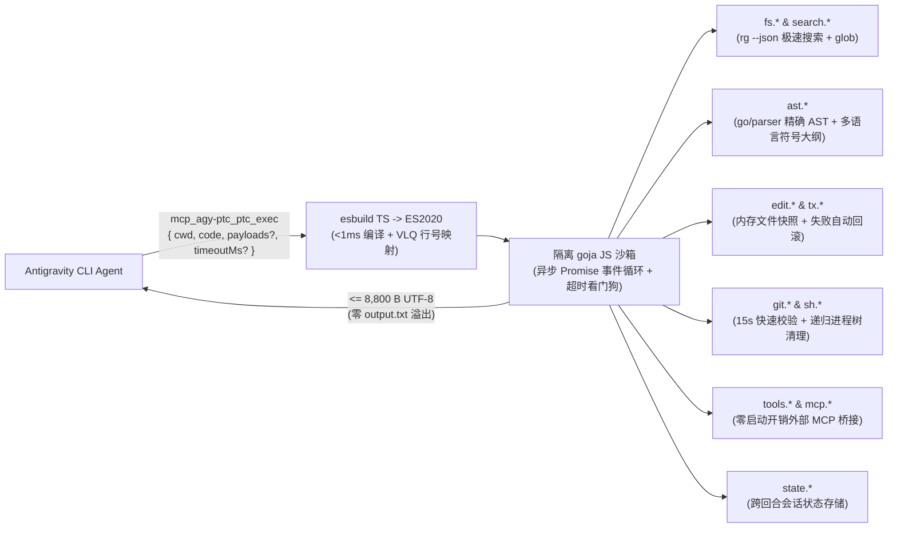

# AgyPTC (`agy-ptc`)

[English](./README.md) | **简体中文**

**面向 Google Antigravity CLI (`agy`) 的编程式工具调用（Code Mode / PTC）运行时与插件**

[](./LICENSE)
[-00ADD8?logo=go)](./go.mod)
[-8E75B2)](./plugin/plugin.json)

`AgyPTC` 受 Cloudflare Code Mode、Anthropic Programmatic Tool Calling 以及 [`pi-fabric`](https://github.com/fabric-runtime/pi-fabric) 启发，为 **Antigravity CLI (`agy`)** 提供原生的 **Code Mode（编程式工具调用）** 能力。

传统 Agent 工具调用往往需要串行往返 8～15 个回合（`grep` -> `read_file` -> `read_file` -> `edit_file` -> `go test` -> 失败手动回滚），不仅推理延迟高，还会把大量中间文件文本塞进上下文窗口，甚至触发 Antigravity `>10 KB` 的 `output.txt` 磁盘落盘惩罚。借助 `AgyPTC`，模型只需向 `mcp_agy-ptc_ptc_exec` 提交**一段极短的 TypeScript 脚本**，搜索、AST 符号大纲、循环过滤、跨文件原子事务修改（失败自动回滚）与外部 MCP 调用即可在 **1 个回合**内于本地 Go 沙箱内存中完成，仅将 `<= 8.8 KB` 的精简结构化摘要返回给模型。

---

## 核心特性对比

| 维度 | 传统串行工具调用 | AgyPTC (`mcp_agy-ptc_ptc_exec`) |
| :--- | :--- | :--- |
| **搜索 -> 读取 -> 修改 -> 验证链路** | 6～15 次串行 LLM 回合往返 | **1～2 个回合**（分支与循环在 `<5ms` 本地沙箱内完成） |
| **上下文窗口污染** | 每次 grep 与文件切片原样堆积进历史 | 中间数据留在沙箱内存，仅返回精简 JSON（`<= 8.8 KB`） |
| **MCP `>10 KB` `output.txt` 落盘惩罚** | 超长输出被迫落盘，额外浪费 1 个读取回合 | **0 落盘溢出** — 超限结果自动存入会话 `state.get("__last_result")` |
| **多文件重构安全性** | 单测失败时半成品修改残留在磁盘 | **`tx.begin()` 内存快照事务**，单测失败 / 抛错 / 超时自动字节级回滚 |
| **误跑长任务 / 子进程卡死防护** | 容易拖死回合或残留孤儿进程占住管道 | **默认 `20s` 超时 + 递归强杀进程树**（Windows `taskkill /T /F` / Unix `-pgid` + `WaitDelay`） |
| **外部运行时依赖** | 需要重型 Python / Deno / Docker 沙箱 | **纯 Go 静态单二进制（`CGO_ENABLED=0`）**，内嵌 `esbuild` + `goja` |

---

## 架构设计



### 快慢任务黄金分工（与原生 `/tasks` 及 `rtk` 无缝协同）

`AgyPTC` 与 Antigravity CLI 内置后台任务系统互补协作，互不抢占：

- **交给 `mcp_agy-ptc_ptc_exec`（`<15s` 快速同步操作）**：代码搜索（`search.rg`/`glob`）、AST 符号定位（`ast.outline`）、批量读取与过滤、多文件事务重构（`tx.begin`）、只读 Git 查询，以及快速编译/类型检查/单包单测（`go vet ./...`、`tsc --noEmit`、`go test ./pkg/...`）。
- **交给原生 `run_command` + `manage_task`（`>15s` 长耗时/后台任务）**：全量集成测试/E2E、重型构建（Gradle/Cargo/Docker）、交互式命令，以及 `IsDaemon: true` 常驻开发服务器——完整保留 `/tasks` 实时日志流与后台完成自动唤醒（Reactive Wakeup）。
- **与 [`rtk`](https://github.com/rtk-ai/rtk) 插件零冲突共存**：`rtk` 仅通过 `PreToolUse` 拦截顶层 `run_command`，不会篡改 `AgyPTC` 内部子进程的结构化 JSON 输出；同时原生后台长任务依然享受 `rtk` 的输出压缩。

---

## 快速开始

### 环境要求

- **Go** `1.25+`（从源码编译时使用）
- **Antigravity CLI (`agy`)** `1.5+`（系统 `PATH` 中需有 `node` 用于跨平台启动脚本）
- **`ripgrep` (`rg`)** *（可选但推荐；若未安装 `rg`，`AgyPTC` 会自动降级到内置纯 Go 正则搜索引擎）*

### 1. 编译并安装插件

```bash
git clone https://github.com/aliothmoon/agy-ptc.git
cd agy-ptc

# macOS / Linux
CGO_ENABLED=0 go build -trimpath -ldflags="-s -w" -o agy-ptc ./cmd/agy-ptc
./agy-ptc install

# Windows (PowerShell)
$env:CGO_ENABLED="0"; go build -trimpath -ldflags="-s -w" -o agy-ptc.exe ./cmd/agy-ptc
.\agy-ptc.exe install
```

执行 `agy-ptc install` 会自动完成：
1. 将插件包与二进制同步至 `~/.gemini/config/plugins/agy-ptc`（支持 Windows 下常驻 MCP 进程运行时的原位热替换升级）。
2. 将 `agy-ptc` CLI 同步到用户 Go Bin 目录（`$GOBIN` 或 `$GOPATH/bin`），方便在任意终端直接调用 `agy-ptc`。
3. 调用 `agy plugin enable agy-ptc` 启用插件，并执行 `agy-ptc doctor` 完成 MCP 握手、`SessionStart` 钩子延迟与 `agy plugin validate --strict` 严格校验（0 警告 / 0 错误）。

### 2. 推荐配置（`~/.gemini/antigravity-cli/settings.json`）

将 `mcp(agy-ptc_ptc/exec)` 加入免确认白名单，并可选开启底部实时 TUI 状态栏：

```json
{
  "allowNonWorkspaceAccess": true,
  "permissions": {
    "allow": [
      "mcp(agy-ptc_ptc/exec)"
    ]
  },
  "statusLine": {
    "type": "command",
    "command": "agy-ptc statusline",
    "stack_with_default": true
  }
}
```

### 3. 两种工作模式

1. **混合模式（Hybrid Mode，默认推荐）**：安装后自动在所有 `agy` 会话中生效。少量已知小文件继续走零开销原生 `read_file`；多步搜索、AST 分析、跨文件事务修改与 `<15s` 快速校验优先走 `mcp_agy-ptc_ptc_exec`；`>15s` 长任务走原生 `run_command` + `manage_task`。
2. **纯粹 Code Mode（`ptc` 专属 Agent）**：通过 `agy --agent ptc` 启动（或在对话中输入 `/agents` 切换至 `ptc`），使用聚焦于 `mcp_agy-ptc_ptc_exec` 的精简工具集运行。

---

## 沙箱 TypeScript API 速查

`code` 会作为 `async` 函数体直接编译（原生支持顶层 `await` 与 `return`，自动剥离 `import type`）。调用时请始终传入当前工作区根目录 `cwd`。

### 多行代码块传参（`P` / `payloads`）
将多行替换代码或模板放在顶层参数 `payloads: { newCode: "..." }` 中，在 `code` 内通过 `P.newCode` 读取，彻底避免多层 JSON 转义报错；若引用了不存在的 `P.<key>`，编译预检会在**零副作用**前提下直接精准报错。

### 文件系统与搜索（`fs.*`、`search.*`）
```ts
const [hits, files, modText] = await Promise.all([
  search.rg("NewEngine", { path: "internal", glob: "*.go", literal: true }),
  search.glob("**/*_test.go"),
  fs.read("go.mod"),
]);
const slice = await fs.read("internal/runtime/engine.go", { startLine: 1, endLine: 60, lineNumbers: true });
const tree = await fs.tree(".", 2);
```
- `fs.read(path, { startLine?, endLine?, lineNumbers? })`（单文件上限 2 MB）· `fs.write(path, content)` · `fs.exists(path)` · `fs.stat(path)` · `fs.list(path)` · `fs.tree(path, depth?)`
- `search.rg(pattern, { path?, glob?, literal?, ignoreCase?, contextLines?, maxResults? })`
- `search.glob(pattern, { path?, maxResults? })`（支持 `{a,b}` 花括号展开与容错回退）
- **跨目录 / 外部路径支持**：相对路径始终基于 `cwd` 解析；在策略允许下（默认开启），所有模块均支持直接传入工作区外的绝对路径或 `../` 跨仓路径（如 `D:/OtherRepo/...`）。

### AST 符号大纲（`ast.*`）
```ts
const outline = await ast.outline("internal/sandbox/executor.go");
const sym = await ast.enclosingSymbol("internal/sandbox/executor.go", 320);
const batch = await ast.outlines(["internal/policy/policy.go", "internal/output/budget.go"]);
```
- `.go` 文件采用标准库 `go/parser` 提取精确起止行号；同时支持 TypeScript、JavaScript、Python、Rust、Java 与 Markdown 符号扫描。

### 跨文件原子事务修改（`tx.*` & `edit.*`）
未提交（`commit`）的事务在验证失败、抛出未捕获异常或触发超时时，**会自动恢复内存快照**（完整保留原文件 CRLF/LF 换行符与文件权限）：

```ts
const t = await tx.begin();

await t.edit("internal/service/handler.go", [
  {
    startLine: 40,
    endLine: 75,
    target: P.before,
    replacement: P.after,
  },
]);

const check = await t.verify([
  { name: "vet", command: "go vet ./..." },
  { name: "unit", command: "go test ./internal/service/..." },
]);

if (!check.ok) {
  await t.rollback();
  return { committed: false, failures: check.failures };
}

await t.commit();
return { committed: true, summary: check.summary };
```

### 只读 Git 与受控命令执行（`git.*`、`sh.*`）
```ts
const [status, log] = await Promise.all([
  git.status(),                    // 非 Git 目录也不会崩 Promise.all，安全返回 { isRepo: false }
  git.log("-n 5 --oneline"),
]);

// 默认 settle: true（非零退出码返回 { ok: false, exitCode, timedOut, output }）
const vet = await sh.exec("go vet ./...", { timeoutSec: 15, compact: true });
const checks = await sh.checks(["go vet ./...", "go test ./internal/compiler/..."]);
```

### 跨回合状态（`state.*`）与外部 MCP 桥接（`tools.*`、`mcp.*`）
```ts
// 零启动开销检索本地缓存的外部 MCP 工具 Schema：
const found = await tools.search("wiki");
if (found.length > 0) {
  const schema = await tools.describe(found[0].ref);
  const res = await mcp.deepwiki.read_wiki_structure({ repoName: "evanw/esbuild" });
  state.set("lastWiki", res);
  return { ref: schema.ref, preview: res.text.slice(0, 400) };
}
```
- 当脚本返回值超过 `8,800` UTF-8 字节时，`AgyPTC` 会在内联返回首尾摘要的同时，自动将完整对象存入 `state.get("__last_result")`（及编号键 `__result_N`），下一回合可直接在内存中切片读取。

---

## 多层超时与子进程防卡死机制

为防止误跑长任务（如 `npm run dev`、全量测试或死循环）导致终端卡死：

1. **顶层 `timeoutMs`**：默认 **`20,000ms`（`20s`）**，支持在 `500ms..120,000ms`（`120s`）范围内按需传参调整（亦可通过环境变量 `AGY_PTC_DEFAULT_TIMEOUT_MS` / `AGY_PTC_MAX_TIMEOUT_MS` 配置）。
2. **单命令超时**：`sh.exec` / `sh.checks` / `tx.verify` 默认单条命令 **`15s`** 超时（支持 `{ timeoutSec }` 与 `{ timeoutMs }`）。
3. **跨平台进程树强杀 + 管道 `WaitDelay`**：
   - **Windows**：以 `CREATE_NEW_PROCESS_GROUP` 启动子进程，超时通过 `taskkill /T /F /PID <pid>` 递归强杀整棵子孙进程树，并配合 `WaitDelay: 500ms` 强制断开被孙进程继承的 `stdout`/`stderr` 句柄，彻底杜绝 `cmd.Run()` 永久挂起。
   - **Unix（Linux / macOS）**：以 `Setpgid: true` 独立进程组运行，超时向 `-pgid` 发送 `SIGKILL` 并配合 `WaitDelay: 500ms` 回收管道。
4. **安全回滚时序**：超时触发时严格按“强杀子进程树 -> 等待文件句柄释放并收集已输出日志 -> 回滚未提交 `tx.*` 文件快照”顺序执行，避免 Windows 文件锁冲突。

---

## 可观测性与 CLI 命令手册

Antigravity CLI 默认 `"verbosity": "medium"` 会在对话界面折叠 MCP 工具入参与返回详情。如需实时查看每次 PTC 执行的 TypeScript 代码与返回结果：

- 在 `agy` 界面按 **`Ctrl+O`**（或在 `settings.json` 中设置 `"verbosity": "high"`），**或者**
- 在旁侧终端运行 **`agy-ptc logs -f`** 实时流式监控！

```bash
agy-ptc logs -f                        # 实时流式打印每次 PTC 调用的输入 TS 代码、操作耗时与返回结果
agy-ptc logs --full --tail 10          # 查看最近 10 次完整输入代码与输出
agy-ptc errors                         # 仅查看报错或包含内部捕获异常（partial_op_error）的记录
agy-ptc logs --id <ptc_id>             # 查看指定运行 ID 的完整源码与调用链明细
agy-ptc stats                          # 统计错误分类占比与高频失败能力热点
agy-ptc bench --recent 15              # 分析本地 Antigravity 会话日志的回合压缩率与 0 溢出指标
agy-ptc run --cwd . --code "return await git.status()"
agy-ptc doctor                         # 执行 MCP 握手、SessionStart 延迟与 agy --strict 插件体检
agy-ptc uninstall                      # 卸载全局或项目级 agy-ptc 插件
```

---

## 安全与权限边界

- **对齐宿主权限配置**：自动读取 `~/.gemini/antigravity-cli/settings.json`（严格遵循 `Deny > Ask > Allow`）。如需强制禁止访问当前工作区以外的任何路径，可设置环境变量 `AGY_PTC_STRICT_WORKSPACE=1` 或在 `settings.json` 中配置 `"allowNonWorkspaceAccess": false`。
- **符号链接与凭据保护**：通过 `filepath.EvalSymlinks` 校验真实路径，无条件拦截敏感目录与凭据文件（`~/.ssh`、`~/.gnupg`、`~/.aws`、`mcp_oauth_tokens.json`、`.git/hooks` 及系统核心目录）。
- **高危命令升级确认**：`git push`、`git reset --hard`、`rm -rf`、`sudo` 等高危命令不会在沙箱内静默执行，而是返回 `APPROVAL_REQUIRED`，引导模型升级至宿主原生 `run_command` 交由用户交互式确认。

---

## 目录结构

```text
AgyPTC/
├── cmd/agy-ptc/             # CLI 入口（mcp, hook, statusline, run, logs, errors, stats, bench, install, doctor）
├── internal/
│   ├── compiler/            # esbuild TS -> ES2020 编译、VLQ 源码行号映射与 payload 静态预检
│   ├── sandbox/             # 隔离 goja VM、异步 Goroutine -> 微任务事件循环、超时看门狗与操作预算
│   ├── capabilities/        # fs, search, ast, edit, tx, git, sh, state, 外部 MCP 桥接与跨平台进程树管控
│   ├── policy/              # 真实路径解析、敏感文件防护与 settings.json 权限规则引擎
│   ├── output/              # <= 8,800 B UTF-8 注水法字节预算器与终端 ANSI/噪声清洗
│   ├── runtime/             # 核心引擎编排、工作区 cwd 安全解析、超限自动转存 state 与实时状态输出
│   ├── mcpserver/           # Stdio JSON-RPC 2.0 MCP 服务端（同时支持 NDJSON 与 Content-Length 帧）
│   ├── snapshot/            # <= 1.5 KB SessionStart 工作区快照钩子与 TUI 状态栏渲染
│   ├── audit/               # JSONL 执行/错误审计日志与错误热点分类器
│   └── bench/               # Antigravity 本地 transcript.jsonl 效率统计工具
└── plugin/                  # Antigravity CLI 插件包（plugin.json, mcp_config.json, hooks.json, rules, agents, skills）
```

---

## 致谢

- 设计灵感源自 [`fabric-runtime/pi-fabric`](https://github.com/fabric-runtime/pi-fabric) 与 [`INK-Q/agy-fast`](https://github.com/INK-Q/agy-fast)。
- 核心沙箱构建于 [`evanw/esbuild`](https://github.com/evanw/esbuild) 与 [`dop251/goja`](https://github.com/dop251/goja) 之上。

## 开源协议

本项目基于 [MIT License](./LICENSE) 开源。
